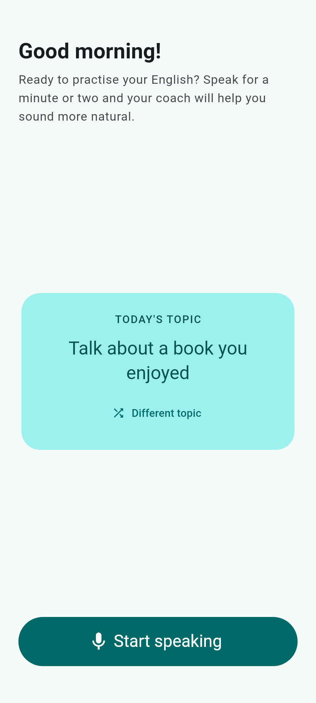
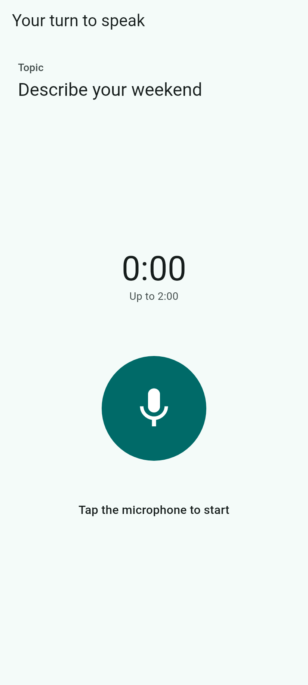
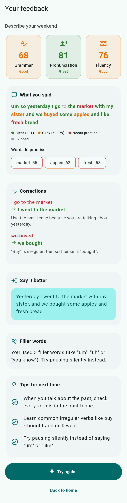
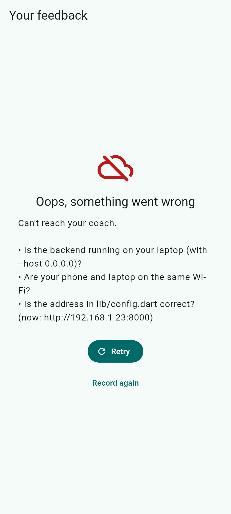

# English Coach

An AI English speaking coach. You record yourself speaking, and the app tells you:

- what you said (speech-to-text with OpenAI Whisper),
- how to fix your grammar and say it better (Claude),
- how good your pronunciation was (Azure Speech).

Then you try again and see if you improved.

| Home | Recording | Feedback | If something goes wrong |
|---|---|---|---|
|  |  |  |  |

## Folders

| Folder | What it is |
|---|---|
| `backend/` | The "brain" that runs on a computer/server (Python + FastAPI). |
| `app/` | The phone app (Flutter). See [Run the phone app](#run-the-phone-app-on-an-android-phone). |

## Current status: Step 5 (backend and phone app are complete)

- ✅ **Speech-to-text.** `/analyze` sends your recording to OpenAI Whisper and returns what you said.
- ✅ **Speaking feedback.** Claude corrects your grammar, rewrites your answer in natural English,
  counts filler words ("um", "like"...), gives a grammar score and 2–3 tips.
- ✅ **Pronunciation scores.** Azure Speech scores accuracy, fluency, completeness and prosody
  (rhythm and intonation), scores every word, and lists the words you found difficult.

Claude and Azure work at the same time, so you don't wait for one and then the other.
If Azure isn't set up or has a problem, you still get the transcript and grammar feedback;
only `pronunciation` is missing (`null`), and `pronunciation_error` says why.

## Files in `backend/`

| File | What it does |
|---|---|
| `main.py` | The server. Receives the recording and puts all the results together. |
| `transcription.py` | Speech → text, using OpenAI Whisper. |
| `feedback.py` | Text → grammar feedback, using Claude. |
| `prompts.py` | **The instructions given to Claude.** Edit this to change the coach's tone or rules. |
| `pronunciation.py` | Pronunciation scores, using Azure Speech. |
| `audio_convert.py` | Converts phone recordings into the WAV format Azure needs, using ffmpeg. |
| `requirements.txt` | The list of tools to install. |
| `.env.example` | Template for your secret keys. |

---

## How to run the backend (step by step)

### 1. Install Python

Download Python 3.10 or newer from https://www.python.org/downloads/.
On Windows, tick **"Add Python to PATH"** during installation.

Check it worked by opening a terminal (Mac: "Terminal", Windows: "Command Prompt") and typing:

```bash
python --version
```

(On Mac you may need to type `python3` instead of `python` everywhere below.)

### 2. Go into the backend folder

```bash
cd path/to/english-coach/backend
```

### 3. Create a "virtual environment" (a private box for this project's tools)

```bash
python -m venv venv
```

Turn it on:

- **Mac / Linux:** `source venv/bin/activate`
- **Windows:** `venv\Scripts\activate`

You'll see `(venv)` at the start of the line. Do this "turn it on" step every time you open a new terminal.

### 4. Install the tools the backend needs

```bash
pip install -r requirements.txt
```

### 4b. Install ffmpeg

ffmpeg is a free program that converts audio between formats. Phones record in m4a or webm, but Azure's
pronunciation scoring only accepts WAV (16 kHz, mono, 16-bit), so the backend uses ffmpeg to convert.
Without ffmpeg, everything still works except pronunciation scoring.

**Windows (easiest way):** open "Command Prompt" or "PowerShell" and type:

```bash
winget install --id Gyan.FFmpeg -e
```

Then **close the terminal and open a new one** (so Windows notices the new program) and check:

```bash
ffmpeg -version
```

If it prints a version number, you're done.

**Windows (by hand, if `winget` doesn't work):**

1. Go to https://www.gyan.dev/ffmpeg/builds/ and download **ffmpeg-release-essentials.zip**.
2. Right-click the zip → **Extract All**. Rename the extracted folder to `ffmpeg` and move it to `C:\`,
   so that the file `C:\ffmpeg\bin\ffmpeg.exe` exists.
3. Tell Windows where it is: press the Windows key, type **"environment variables"**, open
   **"Edit the system environment variables"** → **Environment Variables…**. Under "User variables",
   select **Path** → **Edit** → **New**, type `C:\ffmpeg\bin`, then **OK** on every window.
4. Close and reopen the terminal, then run `ffmpeg -version` to check.

If the server still can't find it, add this line to `backend/.env` (no quotes):

```
FFMPEG_PATH=C:\ffmpeg\bin\ffmpeg.exe
```

**Mac:** install Homebrew from https://brew.sh, then run `brew install ffmpeg`.
**Linux (Ubuntu):** `sudo apt install ffmpeg`.

### 5. Add your secret keys

You need these keys:

- **OpenAI** (speech-to-text): https://platform.openai.com/api-keys. Add a little credit to your OpenAI
  account; Whisper costs about $0.006 per minute of audio.
- **Anthropic** (Claude feedback): https://console.anthropic.com/settings/keys. Add a little credit to your
  Anthropic account too; one piece of feedback costs well under one US cent.
- **Azure Speech** (pronunciation) — optional but recommended. The free tier (F0) includes 5 hours of
  audio per month.
  1. Make a free account at https://portal.azure.com.
  2. Click **Create a resource**, search for **Speech** ("Speech service"), click **Create**.
  3. Choose a **Region** (e.g. *East US*), pick the **Free F0** pricing tier, then **Review + create**.
  4. When it's ready, open it and go to **Keys and Endpoint**. Copy **KEY 1** and the
     **Location/Region** (written like `eastus`, all lowercase, no spaces).

Then:

1. Make a copy of `.env.example` and name the copy `.env` (in the `backend` folder).
2. Open `.env` and replace the fake values with your real keys. It should look like:

   ```
   OPENAI_API_KEY=sk-proj-abc123...
   ANTHROPIC_API_KEY=sk-ant-abc123...
   CLAUDE_MODEL=claude-sonnet-5-5
   AZURE_SPEECH_KEY=abc123...
   AZURE_SPEECH_REGION=eastus
   ```

   No spaces and no quotes.
   `CLAUDE_MODEL` chooses which Claude model gives the feedback; `claude-sonnet-5-5` is a good default.

The `.env` file is listed in `.gitignore`, so it will **never** be uploaded to GitHub.
If you change `.env` while the server is running, stop it (`Ctrl+C`) and start it again.

### 6. Start the server

```bash
uvicorn main:app --reload --host 0.0.0.0
```

You should see `Uvicorn running on http://0.0.0.0:8000`. Leave this window open. Press `Ctrl+C` to stop it.

- `--reload` means the server restarts automatically when you edit the code.
- `--host 0.0.0.0` lets **other devices on your Wi-Fi** (like your phone) reach the server.
  Without it, only your laptop can use it. On your laptop itself, the address is still http://127.0.0.1:8000.
- **Windows:** the first time, Windows Firewall may ask whether to allow Python. Tick **Private networks**
  and click **Allow**. If you missed it, see "My phone can't reach the backend" below.

### 7. Check the server found your keys

Open http://127.0.0.1:8000/ in your browser. You should see `"openai": true`, `"anthropic": true`,
`"azure_speech": true` and `"ffmpeg_found": true`. If `ffmpeg_found` is `false`, see step 4b.
If a key says `false`, the `.env` file is in the wrong folder, is named wrongly (e.g. `.env.txt`), or the key is empty.

### 8. Test with a sample audio file

**Get a recording.** Use your phone's voice recorder app and say a sentence in English,
e.g. *"Yesterday I go to the market and buyed some apples."* Send the file to your computer
(email, AirDrop, Google Drive…). Accepted formats: **m4a, mp3, wav, webm**, plus ogg, flac and mp4. Max 25 MB.

**Option A – in the browser (easiest):**

1. Open http://127.0.0.1:8000/docs.
2. Click **POST /analyze** → **Try it out**.
3. Next to `audio`, click **Choose File** and pick your recording.
4. Click **Execute** and scroll down to **Response body**.

**Option B – from a terminal** (open a *second* terminal; the server must keep running in the first):

```bash
curl -F "audio=@/path/to/your/recording.m4a" http://127.0.0.1:8000/analyze
```

**What you should get back** (it takes a few seconds):

```json
{
  "file_name": "recording.m4a",
  "file_size_bytes": 48213,
  "transcript": "Um, yesterday I go to the market and buyed some apples.",
  "duration_seconds": 3.8,
  "corrections": [
    {
      "original": "I go",
      "corrected": "I went",
      "explanation": "Use the past tense because you are talking about yesterday."
    },
    {
      "original": "buyed",
      "corrected": "bought",
      "explanation": "\"Buy\" is irregular: the past tense is \"bought\"."
    }
  ],
  "better_version": "Yesterday I went to the market and bought some apples.",
  "filler_words": 1,
  "grammar_score": 65,
  "tips": [
    "When you talk about the past, check that every verb is in the past tense.",
    "Learn the common irregular verbs like buy → bought and go → went.",
    "Try pausing silently instead of saying \"um\"."
  ],
  "pronunciation": {
    "accuracy_score": 84.2,
    "fluency_score": 78.0,
    "completeness_score": 100.0,
    "prosody_score": 71.5,
    "overall_score": 81.0,
    "words": [
      {"word": "Um", "accuracy_score": 90, "error_type": "None"},
      {"word": "yesterday", "accuracy_score": 88, "error_type": "None"},
      {"word": "market", "accuracy_score": 62, "error_type": "Mispronunciation"},
      "..."
    ],
    "difficult_words": [
      {"word": "market", "accuracy_score": 62, "error_type": "Mispronunciation"}
    ]
  },
  "pronunciation_error": null
}
```

Claude's exact words will be different every time.

**What the pronunciation scores mean** (all 0–100, higher is better):

| Score | Meaning |
|---|---|
| `accuracy_score` | How correctly the sounds of each word were pronounced. |
| `fluency_score` | How smoothly you spoke, without unnatural pauses. |
| `completeness_score` | How many of the words you meant to say you actually said. |
| `prosody_score` | How natural your rhythm, stress and intonation sound. |
| `overall_score` | All of the above combined. Your weakest score counts most. |

Each word in `words` has an `error_type`:

| `error_type` | Meaning |
|---|---|
| `None` | No problem. |
| `Mispronunciation` | The word was said, but not pronounced well. |
| `Omission` | The word was skipped. |
| `Insertion` | An extra word that wasn't expected (often a filler like "uh"). |
| `UnexpectedBreak` / `MissingBreak` | A pause in the wrong place / a pause was missing. |
| `Monotone` | Said in a flat voice. |

`difficult_words` lists the words you said that scored below 70. It doesn't include skipped or extra words.

The reference text (what Azure compares your speech to) is the Whisper transcript, so Azure scores
*how well* you said the words you said, not whether they were the "right" words.

**If pronunciation is missing**, `pronunciation` is `null` and `pronunciation_error` explains why,
for example: `"Pronunciation scoring is turned off: AZURE_SPEECH_KEY and AZURE_SPEECH_REGION must both be set in backend/.env."`

### Changing how the coach talks

Open `backend/prompts.py`. It contains, in plain English, the instructions Claude follows: be friendly,
ignore punctuation, keep explanations to one simple sentence, how to score, and so on. Change the wording,
save, and the server restarts by itself (thanks to `--reload`). Keep the five field names the same,
because the code reads them.

### If something goes wrong

Instead of crashing, the server replies with a `detail` message telling you what happened:

| Message starts with… | What to do |
|---|---|
| `OPENAI_API_KEY is missing` / `ANTHROPIC_API_KEY is missing` | Add the key to `backend/.env` and restart the server. |
| `OpenAI rejected the API key` / `Anthropic rejected the API key` | The key is wrong or was deleted. Make a new one and paste it in again. |
| `Anthropic doesn't recognise the model` | Check the spelling of `CLAUDE_MODEL` in `.env` (or delete that line to use the default). |
| `We couldn't hear any speech` | The recording was silent or too quiet. Record again closer to the microphone. |
| `came back in the wrong format twice` | Rare. Claude's answer was garbled twice in a row. Just try again. |
| `Claude declined to give feedback` | Claude wouldn't comment on what was said. Record something different. |
| `Unsupported audio format` | Send an m4a, mp3, wav or webm file. |
| `The audio file is empty` / `too big` | Record again; keep it under 25 MB. |
| `OpenAI could not read this audio file` | The file is broken or isn't really audio. Try another recording. |
| `too many requests` / `no credit` / `out of credit` | Wait a minute, or add credit to your OpenAI or Anthropic account. |
| `Could not reach OpenAI` / `Could not reach Anthropic` | Check your internet connection. |

Pronunciation problems never stop the request. Instead you'll see one of these in `pronunciation_error`:

| `pronunciation_error` starts with… | What to do |
|---|---|
| `Pronunciation scoring is turned off` | Add `AZURE_SPEECH_KEY` and `AZURE_SPEECH_REGION` to `backend/.env`. |
| `ffmpeg is not installed` | Install ffmpeg (step 4b), then restart the terminal and the server. |
| `FFMPEG_PATH in .env points to` | The path in `.env` is wrong. Check where `ffmpeg.exe` really is. |
| `Azure rejected the key` | Check the key, and that the region matches your Azure resource. |
| `Could not reach Azure` | Check your internet connection and `AZURE_SPEECH_REGION` (e.g. `eastus`). |
| `Azure says we've used too much` | Free-tier limit reached. Wait, or upgrade the Azure resource. |
| `The recording couldn't be converted` | The file may be damaged. Try another recording. |
| `Azure couldn't hear any clear speech` | Record again, closer to the microphone. |

---

## Run the phone app on an Android phone

The app is in the `app/` folder. It's written in Flutter, which builds Android and iPhone apps from one code base.

### A. Install Flutter and Android Studio (one time, on Windows)

1. Install **Git for Windows**: https://git-scm.com/download/win (Flutter needs it).
2. Install **Android Studio**: https://developer.android.com/studio. Open it once and let it finish
   the setup wizard (it downloads the Android SDK).
3. In Android Studio: **More Actions** (or **Settings**) → **SDK Manager** → **SDK Tools** tab → tick
   **Android SDK Command-line Tools** → **Apply**.
4. Install **Flutter**: follow https://docs.flutter.dev/get-started/install/windows/mobile.
   The easiest way: in Android Studio, **Plugins** → search **Flutter** → **Install**, then use
   **New Flutter Project** → it offers to download the Flutter SDK for you.
   Make sure the Flutter `bin` folder is on your PATH (the guide shows how).
5. Open a **new** terminal and run:

   ```bash
   flutter doctor --android-licenses
   ```

   Type `y` to accept each license. Then run:

   ```bash
   flutter doctor
   ```

   You want green ticks next to **Flutter** and **Android toolchain**. (Ignore Chrome, Visual Studio and Xcode.)

### B. Prepare your Android phone (one time)

1. **Turn on Developer options:** Settings → About phone → tap **Build number** 7 times.
   (On some phones it's under Settings → About phone → Software information.)
2. **Turn on USB debugging:** Settings → System → Developer options → **USB debugging** → on.
3. Connect the phone to the laptop with a USB cable. On the phone, tap **Allow** when it asks
   "Allow USB debugging?".
4. Check the laptop sees the phone:

   ```bash
   flutter devices
   ```

   Your phone should be in the list.

### C. Find your laptop's IP address (Windows)

Your phone needs your laptop's address on the Wi-Fi network.

1. Open **Command Prompt** and type:

   ```bash
   ipconfig
   ```

2. Find the section called **Wireless LAN adapter Wi-Fi** (not "Ethernet" or "vEthernet").
3. Look at the line **IPv4 Address**, e.g. `IPv4 Address. . . . : 192.168.1.23`.
   That number is your laptop's IP address.

This address can change when you reconnect to Wi-Fi or use a different network. If the app suddenly
can't reach the backend, run `ipconfig` again.

### D. Tell the app the address

Open `app/lib/config.dart` and change this line to your IP address (keep `http://` and `:8000`):

```dart
const String backendUrl = 'http://192.168.1.23:8000';
```

### E. Check the phone can reach the backend

1. Start the backend with `--host 0.0.0.0` (backend step 6).
2. Make sure the phone is on the **same Wi-Fi** as the laptop (not mobile data).
3. On the phone, open Chrome and go to `http://YOUR-IP:8000/` (e.g. `http://192.168.1.23:8000/`).
   You should see `"status": "ok"`. If you do, the app will be able to connect too.

### F. Run the app

```bash
cd app
```

```bash
flutter pub get
```

```bash
flutter run
```

The first build takes a few minutes. The app then opens on your phone and stays installed.
While `flutter run` is running, press `r` in the terminal to reload after changing code, or `q` to quit.

### Using the app

1. **Home:** you get a random topic. Tap **Different topic** for another one, then **Start speaking**.
2. **Recording:** tap the microphone and allow microphone access. Speak, then tap the red stop button.
   The recording stops by itself after 2 minutes.
3. **Feedback:** wait for "Your coach is listening..." (usually 10–30 seconds). Then scroll through your
   scores, your coloured words, corrections, a better version, filler words and tips.
   Tap **Try again** to record the same topic again and see if you improved.

### My phone can't reach the backend

The app shows "Can't reach your coach" with a **Retry** button. Check, in this order:

1. The backend is running and was started with `--host 0.0.0.0`.
2. Phone and laptop are on the same Wi-Fi. Some public, office or guest networks block devices
   from talking to each other; a home network or your phone's hotspot usually works.
3. `app/lib/config.dart` has the right IP address (run `ipconfig` again), then restart the app.
4. **Windows Firewall** may be blocking it. Open the Windows menu → **"Allow an app through Windows Firewall"**
   → **Change settings** → find **Python** → tick **Private** → **OK**. Also make sure your Wi-Fi is set
   to **Private** (Settings → Network & Internet → Wi-Fi → your network → Network profile type → **Private**).
5. Test from the phone's browser again (step E).

### App files

| File | What it does |
|---|---|
| `lib/config.dart` | **The backend address** and other settings (max recording length, timeout). |
| `lib/topics.dart` | The 30 speaking topics. Add your own! |
| `lib/main.dart` | Starts the app and sets the colours (change `seedColor` to restyle everything). |
| `lib/screens/home_screen.dart` | Screen 1: greeting, topic, "Start speaking". |
| `lib/screens/recording_screen.dart` | Screen 2: record button, timer, microphone permission. |
| `lib/screens/results_screen.dart` | Screen 3: uploads the recording and shows the feedback or an error. |
| `lib/services/coach_api.dart` | Sends the recording to the backend and turns errors into friendly messages. |
| `lib/models/analysis_result.dart` | Turns the backend's JSON answer into Dart objects. |
| `lib/widgets/` | Reusable pieces: score cards, coloured transcript, score colours. |
| `test/widget_test.dart` | Automatic checks. Run them with `flutter test`. |

Android and iPhone settings that were changed:

- `android/app/src/main/AndroidManifest.xml`: microphone and internet permissions, app name "English Coach".
- `android/app/src/main/res/xml/network_security_config.xml`: allows plain `http://` so the app can talk to
  your laptop. **For local testing only**; use https before publishing the app.
- `ios/Runner/Info.plist`: the microphone permission message, and permission to use plain http on the local network.

## Endpoints

| Method | Address | What it does |
|---|---|---|
| GET | `/` | Health check — is the server alive, which keys are loaded. |
| POST | `/analyze` | Send an audio file (form field name: `audio`). Returns the transcript, Claude's feedback and Azure's pronunciation scores. |
